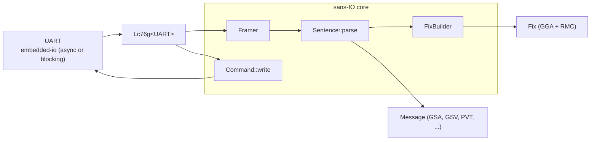

# lc76g

Driver for the Quectel LC76G GNSS module over a UART, written for the MARV V2 Rev 1 flight controller. The crate is `no_std` with three layers: byte-level pieces that need no I/O (the NMEA `Framer`, the sentence decoders `Sentence::parse`, the fix builder `FixBuilder`, the command encoder `Command::write`), `Lc76g` over the `embedded-io-async` traits, and `blocking::Lc76g` over the `embedded-io` traits. Dependencies: `embedded-io` 0.7, `embedded-io-async` 0.7, `embedded-hal` 1.0, `embedded-hal-async` 1.0 and optionally `defmt`. Version 0.1.0; the API may still change. No embassy crate is needed.



## Quick start

No hardware needed. The bytes go through the framer, each valid sentence is decoded, and the fix builder joins the GGA and RMC of one epoch. The coordinates are made up. A bad checksum or a malformed field comes back as a value, not as a panic.

```rust
use lc76g::{FixBuilder, Framer, Message, Sentence};

let stream: &[u8] = b"$GNGGA,120000.000,0112.345678,N,00234.567890,E,1,12,0.60,10.500,M,-17.000,M,,*62\r\n\
$GNRMC,120000.000,A,0112.345678,N,00234.567890,E,0.250,90.50,111126,,,A,V*0F\r\n\
$GNZDA,120000.000,11,11,2026,,*4D\r\n";

let mut framer = Framer::new();
let mut builder = FixBuilder::new();
let (mut fix, mut zda) = (None, None);
for &byte in stream {
    if let Some(sentence) = framer.push(byte) {
        let message = sentence.parse();
        if let Message::Zda(z) = message {
            zda = Some(z);
        }
        if let Some(f) = builder.push(&message) {
            fix = Some(f);
        }
    }
}
let fix = fix.unwrap();
assert!(fix.valid);
assert_eq!(fix.time.unwrap().millis_of_day(), 12 * 3_600_000);
assert_eq!(fix.alt_mm, Some(10_500));
assert!(fix.lat_deg().unwrap() > 1.2 && fix.lat_deg().unwrap() < 1.21);
assert_eq!(zda.unwrap().date.unwrap().year, 2026);
assert_eq!(framer.stats().sentences, 3);

// Wrong checksum: no sentence is produced.
let wrong = "$GNGGA,120000.000,0112.345678,N,00234.567890,E,1,12,0.60,10.500,M,-17.000,M,,*00";
assert!(Sentence::new(wrong).is_none());
// Right checksum, malformed latitude: the result is a value.
let malformed = "$GNGGA,120000.000,01x2.345678,N,00234.567890,E,1,12,0.60,10.500,M,-17.000,M,,*2B";
assert_eq!(Sentence::new(malformed).unwrap().parse(), Message::Malformed);
```

The driver on a UART. Here a scripted UART stands in for the hardware; on the board `init(&Config, &mut delay)` (not run here) would follow `version`. The full on-board sequence is in `hil/src/bin/lc76g_smoke.rs`.

```rust
# use core::convert::Infallible;
# use core::future::Future;
# use core::pin::pin;
# use core::task::{Context, Poll, Waker};
# use embedded_io_async::{ErrorType, Read, Write};
# struct Script<'a> { rx: &'a [u8], tx: Vec<u8> }
# impl ErrorType for Script<'_> { type Error = Infallible; }
# impl Read for Script<'_> {
#     async fn read(&mut self, buf: &mut [u8]) -> Result<usize, Infallible> {
#         let n = buf.len().min(self.rx.len());
#         let (head, tail) = self.rx.split_at(n);
#         buf[..n].copy_from_slice(head);
#         self.rx = tail;
#         Ok(n)
#     }
# }
# impl Write for Script<'_> {
#     async fn write(&mut self, buf: &[u8]) -> Result<usize, Infallible> {
#         self.tx.extend_from_slice(buf);
#         Ok(buf.len())
#     }
#     async fn flush(&mut self) -> Result<(), Infallible> { Ok(()) }
# }
# fn block_on<F: Future>(f: F) -> F::Output {
#     let mut f = pin!(f);
#     let mut cx = Context::from_waker(Waker::noop());
#     loop {
#         if let Poll::Ready(v) = f.as_mut().poll(&mut cx) { return v; }
#     }
# }
# let rx = b"$PQTMVERNO,LC76GABNR02A01S,2022/09/14,11:47:03*3D\r\n\
# $GNGGA,120000.000,0112.345678,N,00234.567890,E,1,12,0.60,10.500,M,-17.000,M,,*62\r\n\
# $GNRMC,120000.000,A,0112.345678,N,00234.567890,E,0.250,90.50,111126,,,A,V*0F\r\n";
# block_on(async {
let mut gps = lc76g::Lc76g::new(Script { rx, tx: Vec::new() });
let version = gps.version().await.unwrap();      // sends $PQTMVERNO, waits for the answer
assert_eq!(version.version(), "LC76GABNR02A01S");
let fix = gps.read_fix().await.unwrap();         // next GGA + RMC pair of one epoch
assert!(fix.valid);
assert_eq!(gps.stats().fixes, 1);
# });
```

## Docs

| Page | In one line |
|---|---|
| [docs/driver.md](docs/driver.md) | What the application provides, rules for correct use (fix-interval restarts, commands, `init`), errors, not covered |
| [docs/sentences.md](docs/sentences.md) | Decoded sentences, framer, fix builder, units, commands, `$PQTMPVT` |
| [docs/device.md](docs/device.md) | Module facts: protocol, default stream, 10 Hz budget, PPS, pins, specification |
| [hil/README.md](hil/README.md) | On-board test programs and how to run them |

## Status

- Host tests: `cargo test --locked` (unit tests, property tests in `src/fuzz_tests.rs`, doctests). Property tests feed arbitrary bytes in arbitrary chunks to the framer and the driver, arbitrary text to every field parser, check-summed sentences around random fields, and arbitrary replies to the command layer.
- On the board (MARV V2 Rev 1, UART1 and PPS, one module firmware `LC76GABNR12A05S`): smoke, aux, stream and resync programs; see [hil](hil/README.md).
- Not verified on the module: `$PQTMPVT` decoded through this driver, the sign of the down velocity, reading through a DMA UART, a second module firmware; see [driver](docs/driver.md).
- Cargo feature `defmt` (off by default): `defmt::Format` on public types and `embedded-io/defmt`, `embedded-io-async/defmt`.

## Used by

Standalone: the current MARV V2 firmware does not use this crate.

## MARV project

| Repository | Role |
|---|---|
| [MARV-FC](https://github.com/Lmx154/MARV-FC) | Flight-controller firmware for the MARV V2 board (RP2350B) |
| [MARV-GCS](https://github.com/Lmx154/MARV-GCS) | Ground station (`marv-gcs`) and command line (`marv-cli`) |
| [MARV-sim](https://github.com/Lmx154/MARV-sim) | Simulator that runs the firmware's flight code |
| Sensors | [icm45686](https://github.com/Lmx154/icm45686-rs) · [lsm6dsk320x](https://github.com/Lmx154/lsm6dsk320x-rs) · [bmp581](https://github.com/Lmx154/bmp581-rs) · [bmm350](https://github.com/Lmx154/bmm350-rs) · [sam-m10q](https://github.com/Lmx154/sam-m10q) · [adc-battery](https://github.com/Lmx154/adc-battery) |
| Board I/O | [pio-sdmmc](https://github.com/Lmx154/pio-sdmmc-rs) · [qmi-psram](https://github.com/Lmx154/qmi-psram-rs) · [ws2812c](https://github.com/Lmx154/ws2812c-rs) · [usb-cdc](https://github.com/Lmx154/usb-cdc) · [pio-uart](https://github.com/Lmx154/pio-uart) |
| Motors and links | [dshot](https://github.com/Lmx154/dshot-rs) · [esc-passthrough](https://github.com/Lmx154/esc-passthrough) · [rc-port](https://github.com/Lmx154/rc-port) · [crsf-codec](https://github.com/Lmx154/crsf-codec) · [mavlink-device](https://github.com/Lmx154/mavlink-device) · [marv-dialect](https://github.com/Lmx154/marv-dialect) |
| Other drivers | **lc76g** (Quectel LC76G GNSS) |

## License

MIT, see `LICENSE`.
