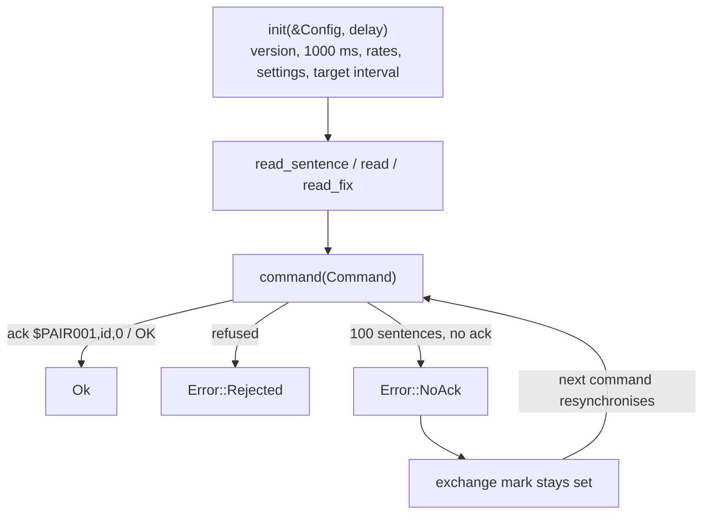

# Driver

Part of [lc76g](../README.md)

What `Lc76g` needs from the application, the rules that keep it correct, and what is not covered. Sentence decoding is in [sentences](sentences.md); module facts are in [device](device.md).

## What the application provides

| Item | Detail |
|---|---|
| UART | 115200 baud, 8N1. Async: `embedded_io_async::Read`, plus `Write` to send commands. Blocking: `embedded_io::Read` and `Write`. Receive-only wiring works for `read_sentence`, `read` and `read_fix` |
| Buffering | a buffered UART: the module sends bursts of about 20 sentences (1.4 kB, 120 ms at 115200 baud) that a one-byte FIFO would overrun. With embassy-rp 0.10 the on-board program uses `BufferedUart` with a 4096-byte receive and 256-byte transmit buffer |
| Timeouts | the driver owns no timer, pin or task. On a silent line `read*` waits forever: wrap calls in the executor's timeout (async) or give the UART a read timeout (blocking) |
| Delay | lent to `init` (`embedded_hal_async::delay::DelayNs`, or `embedded_hal::delay::DelayNs` for blocking). When the configured fix interval is not 1000 ms, `init` waits `FIX_INTERVAL_SETTLE_MS` (500 ms) before its last command; at 1000 ms it is never used |
| PPS | the application owns the pin and its time-stamping; `Command::SetPps` configures the module's pulse |

## Rules for correct use

- **Two fix-interval commands restart the module.** When the first `$PAIR050` changes the rate and a second follows soon after, the module answers `$PAIR001,050,1` (being processed), sends nothing more, restarts by itself about 1.8 s later and returns at its stored settings (1 Hz, stored sentence set). Spacing from the first acknowledgement to the second send: 18, 26, 46, 47, 50, 70, 120 and 170 ms restarted it (8 of 8); 207, 271, 370, 470, 519, 771 and 970 ms were accepted (7 of 7); 97 ms was accepted once. A resend does not help. After every applied change the module sends an unsolicited `$PAIR001,124,0` 114 to 241 ms after the acknowledgement. `init` therefore holds `FIX_INTERVAL_SETTLE_MS` = 500 ms before its last fix-interval command. `command` does not enforce this: a caller sending `Command::SetFixInterval` itself waits at least that long between two.
- **Right after power-on a fix-interval change does not complete, and the interval can survive a power-off.** With the module's backup supply fed, it came up at the interval set before the power-off (200 ms) with its default sentence set and answered the version query in 11 ms; `$PAIR050,1000` about 0.1 s after its first sentence got `$PAIR001,050,1`, then `$PAIR001,124,0` and `$PAIR011,001` at about 240 ms, and no final result within 100 sentences (about 1.5 s), so `init` returned `Error::NoAck` and the interval stayed. The same `init` 5 s later succeeded every time. Call `init` again after a failure; do not assume the module starts at 1000 ms.
- **No panics on module input.** Malformed input is an error value (`Message::Malformed`, `None`, a counted checksum error or overflow). `src/lib.rs` carries a `deny` block of clippy lints (`unwrap_used`, `expect_used`, `panic`, `unreachable`, `todo`, `unimplemented`, `indexing_slicing`) outside tests, enforced by `cargo clippy`; `forbid(unsafe_code)` is enforced by the compiler; `src/fuzz_tests.rs` holds the property tests. This is lints plus randomised tests, not a proof, and the lint block does not cover arithmetic overflow.
- **Dropped reads.** Dropping a `read*` or `command` future loses nothing the driver already read; a command write cut short may leave a partial sentence on the wire, which the module discards by its checksum (`dropping_a_read_future_loses_nothing`, `src/tests.rs`). With the blocking driver a UART read timeout comes out as `Error::Uart` and nothing read is lost.
- **Commands.** `command` returns `Ok(())` when the module acknowledges (`$PAIR001,<id>,0` for PAIR commands, `OK` for PQTM commands; "being processed" keeps waiting), `Err(Error::Rejected { command, code })` when it refuses, and `Err(Error::NoAck)` after `ACK_SENTENCE_LIMIT` (100) other sentences without the acknowledgement. A `Command::Raw` whose reply is not known returns once sent. Fixes seen during `command` are discarded and counted in `Stats::fixes_discarded`.
- **Abandoned commands.** An acknowledgement is matched by command number only, so the driver keeps a private mark that an exchange is open: set before the first byte of a command is written, cleared when its own acknowledgement has been read. It stays set when the `command` future is dropped (for example by a timeout), after `NoAck` and after a UART error. The next `command` (also `version`, `init`, `save_settings`) then resynchronises first: it sends a line end and a read-only query (`$PAIR051`, `$PAIR081` or `$PQTMVERNO`, the first whose number is neither the abandoned nor the new command's; none changes a setting or writes flash) and discards sentences, at most `ACK_SENTENCE_LIMIT`, up to the query's answer. If the query gets no answer the call returns `Err(Error::NoAck)` without sending the command, and the next call tries again; the next attempt uses another query. With the mark clear the driver sends exactly the command bytes. This assumes the module answers commands in the order received. Limit: when the caller's own commands are two of the three queries the same query is reused, and the driver remembers only the last unanswered query, so after two unfinished resynchronisations in a row a late answer can end a resynchronisation early and then be taken for the answer to a later call of that query command.
- **Stored configuration.** `init` never writes the module's flash; settings are volatile until power loss or reset. `Command::SaveSettings` (`$PAIR513`) writes flash and `Command::SavePqtm` (`$PQTMSAVEPAR`) its NVDM; `Lc76g::save_settings` sends both. `Command::Start` (`Hot`, `Warm`, `Cold`, `FullCold` = `$PAIR004` to `$PAIR007`) restarts the GNSS engine, and `FullCold` also resets to factory settings. Above 1 Hz the specification requires powering the GNSS system off (`$PAIR382,1`, `$PAIR003`) before `$PAIR513` and on again (`$PAIR002`) after; `save_settings` does not do this. `Command::Raw` can send any sentence body that is non-empty, at most 156 bytes (`MAX_SENTENCE_LEN` - 4), printable ASCII and free of `$` and `*`; otherwise `Error::InvalidCommand` and nothing is sent.
- **Other errors.** `Error::Eof`: the UART returned zero bytes (line closed). `Error::InvalidConfig`: `init` found a value outside the accepted range or a configuration that breaks the stream budget; nothing was sent.
- **`init` is not atomic.** It checks the configuration, queries the version, sets 1000 ms, then the sentence rates and other settings, and the target interval last. An error part-way leaves the module partly configured and at 1 Hz; call `init` again.
- **`release()`** returns the UART; bytes already read from it but not yet consumed by the driver are lost.

## Not covered and not verified

Not implemented: sentences outside the table in [sentences](sentences.md) (RLM and other PAIR and PQTM replies decode to `Other`); binary protocols; typed read-back of settings (the on-board program reads them through `Command::Raw`); baud-rate change and constellation selection (the module restarts); the module's EPE merged into `Fix`; time synchronisation from PPS; recovery of a module left flooded by other software; jamming status, SBAS, elevation mask, low power, geofence and logging (no `Command` variant). An earlier run recorded one `NoAck` from `init` with the default configuration while the module ran at 10 Hz; it did not recur in 16 later runs and the cause was not found.

Not verified on the real module:

- GNS, ZDA, GST and GRS are decoded and cross-checked against RMC, GGA and GSA by `lc76g_aux` (ZDA 10 of 10, GST 10 of 10, GRS 40 of 40, GNS 10 of 10, no mismatch); `lc76g_smoke` never examines them.
- GNS layout: the module sends the standard 13-field layout with a 6-character mode indicator (`AAAANN` seen). The decoder also accepts the 14 or 15 field layout of the manufacturer's example; any other count is `Message::Malformed`. Only the 13-field layout has been seen. Mode letters `P` and `S` are rejected; `A D E F M N R` are accepted.
- `$PQTMPVT`: measured with a program's own framer (100 sentences, 0 malformed), not through this driver. The sign of the down velocity and its response to vertical motion are not checked: only a board at rest was measured.
- Reading through a DMA UART has not been tried. Only firmware `LC76GABNR12A05S` was used.

## Code

| Path | Contents |
|---|---|
| `src/lib.rs` | `Lc76g`, `Error`, `Stats` |
| `src/nmea.rs`, `src/field.rs` | framer and field parsers |
| `src/sentence.rs`, `src/aux_sentences.rs` | decoders and `Message` |
| `src/fix.rs`, `src/units.rs` | fix builder, unit conversions |
| `src/command.rs`, `src/config.rs` | commands, `Config` |
| `src/blocking.rs` | blocking front-end |

## Related

[sentences](sentences.md) · [device](device.md) · [hil](../hil/README.md) · [README](../README.md)
