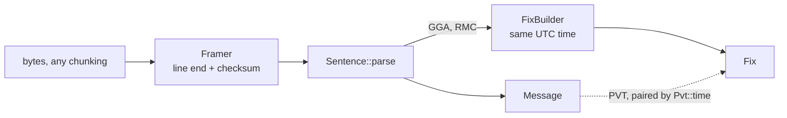

# Sentences, fixes and commands

Part of [lc76g](../README.md)

How bytes become messages and fixes, and which commands the encoder offers. The framer, decoders, fix builder and encoder work on bytes with no I/O.

## Decoded sentences

| Sentence | Yields |
|---|---|
| GGA | time, position, quality, satellites used, HDOP, altitude, geoid separation |
| RMC | time, date, validity, position, speed, course, mode |
| GSA | fix type, PDOP/HDOP/VDOP, up to 12 satellite IDs, system ID |
| GSV | up to four satellites (ID, elevation, azimuth, C/N0) per sentence |
| VTG, GLL | course and speed; position, time, validity |
| ZDA | time, date, local zone hour and minute (the module leaves the zone empty); `utc_unix_ms()` |
| GNS | time, position, one mode letter per constellation, satellites used, HDOP, altitude, geoid separation |
| GST | standard deviations (RMS, ellipse axes, orientation, lat, lon, altitude), mm |
| GRS | mode and twelve range residuals, mm; optional system and signal ID |
| `$PAIR001` | acknowledgement of a PAIR command (`Ack`) |
| `$PQTMVERNO`, `$PQTMEPE` | firmware version; estimated position error (N, E, D, 2D, 3D, mm) |
| `$PQTMPVT` | message version 1: GPS time of week, UTC date and time, quality, fix mode, satellites used, leap seconds, position, altitude, geoid separation, velocity north / east / down (mm/s, signed), ground speed, heading (0.01 degree), HDOP and PDOP. Another message version is `Message::PvtUnsupportedVersion`. The sign of the down velocity is not verified on the module |
| `$PQTMCFGMSGRATE,OK,PQTMPVT,<rate>[,1]` | answer to a read of the PVT rate (`Message::PvtRate`) |
| `$PQTM...,OK/ERROR` | reply to a PQTM command |

`Message::Other` is any valid sentence not listed; `Message::Malformed` is a valid checksum with fields that do not fit the layout. A field the module leaves empty decodes to `None`.

## Framer, fix builder, units

- **Framer.** Bytes in any chunking; a sentence is returned when its line ends and its checksum is right; it resynchronises on `$`. `Framer::stats()` counts sentences, checksum errors (including sentences cut off by the next `$`) and overflows (longer than `MAX_SENTENCE_LEN` = 160 bytes from `$` to the last checksum digit; derived from the field widths of `$PQTMPVT`, the longest sentence: 155 bytes worst case, 134 to 139 seen). `Lc76g::stats()` adds fixes, dropped epochs and discarded fixes; counters saturate.
- **Fix builder.** A `Fix` is made when the GGA and RMC of the same UTC time have both arrived: time, date, `valid` (RMC status), quality, `lat_e7`, `lon_e7`, `alt_mm`, `geoid_sep_mm`, `speed_mm_s`, `course_cdeg`, `sats_used`, `hdop_x100`, and from the latest GSA `fix_type`, `pdop_x100`, `vdop_x100` (up to a second older above 1 Hz; `None` before a GSA). A mismatched epoch is dropped and counted.
- **Units.** Integers: 1e-7 degree, mm, mm/s, 0.01 degree, DOP x100. `units` and `Fix::lat_deg` and similar convert to floating point. Coordinates have six decimals of minutes in drone mode; the decoders accept six or seven.

## Commands

`Command`: version query, fix interval (100 to 1000 ms), sentence rate per type, rate reset, navigation mode, PPS, start types, EPE on/off, `$PQTMPVT` rate set (`SetPvt`) and read (`GetPvtRate`, `Lc76g::pvt_rate()`), save, `Raw`. Command results and errors are in [driver](driver.md).

`Config` and `init` apply a full set. `init` refuses a configuration that breaks the stream budget: below 1000 ms, GSA, GSV and GRS at most once per second (`Config::with_fix_interval` sets rates that fit). `Config::pvt_rate` is 0 by default (`init` sends nothing about PVT, so a PVT output enabled earlier stays on) and 1 to 20 means every N-th fix: `init` then sends `$PQTMCFGMSGRATE,W,PQTMPVT,<rate>,1` after the EPE setting. With a PVT rate set, `Config::is_valid` also applies a byte budget: the enabled sentences at upper-bound sizes (92 bytes with CR LF for the standard ones, estimates; PVT 162 bytes) per second at the fix interval must stay within 80 % of the 11520 bytes/s of the line. Every sentence on at 10 Hz fits without PVT and not with PVT at every fix; the 10 Hz flight set with PVT at every fix fits.

## PVT and the fix

`Fix` does not carry the PVT. On the module the PVT arrives about 16 ms after the RMC of its epoch, after `FixBuilder` has completed the fix at the RMC, and the driver does not delay a fix to wait for it. `read_fix` returns the same fix with PVT on or off and skips the PVT sentence; `Lc76g::read` (or the sans-IO `Sentence::parse`) returns it as `Message::Pvt`, to be paired with the fix of the same epoch by `Pvt::time` (equal to the RMC time of the epoch, 100 of 100 paired).

## Code

`src/nmea.rs` (framer), `src/sentence.rs` and `src/aux_sentences.rs` (decoders), `src/fix.rs` (fix builder), `src/command.rs` (encoder), `src/units.rs`.

## Related

[driver](driver.md) · [device](device.md) · [README](../README.md)
